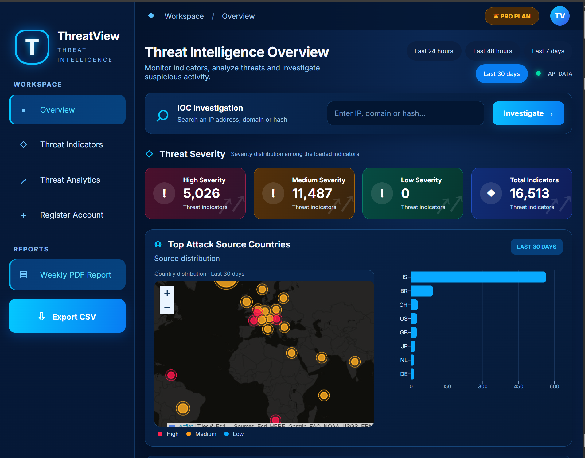
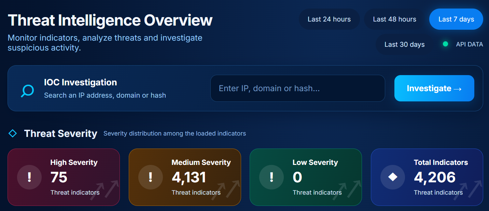
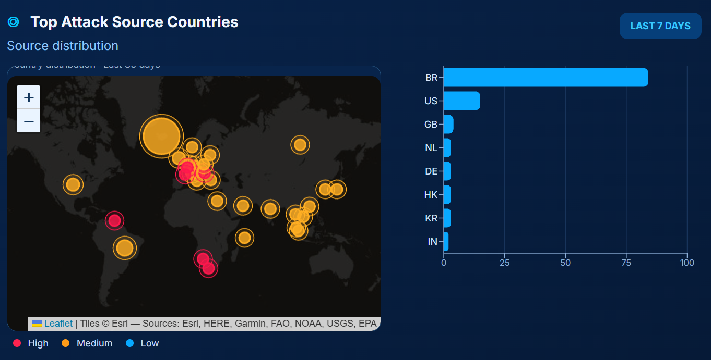
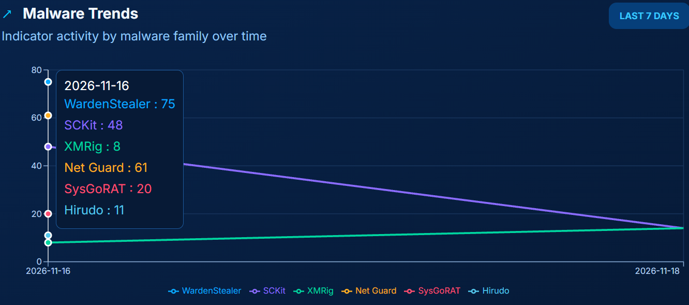
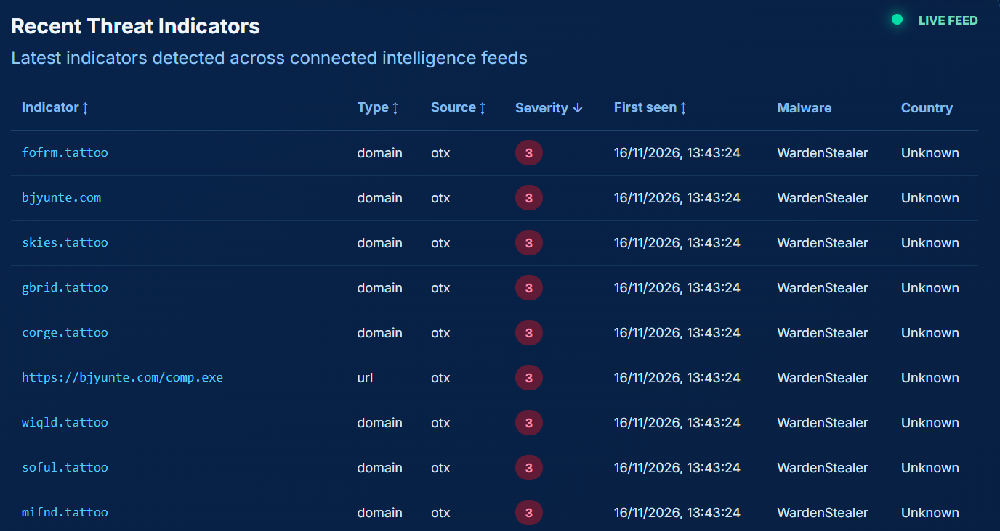

# ThreatView – Tiered Threat Intelligence Dashboard

# Project Report

**Project Title:** ThreatView – A Tiered Threat Intelligence Dashboard  
**Project Type:** Security Software Engineering Project  
**Domain:** Cybersecurity and Threat Intelligence  
**Technology:** Python, FastAPI, React, PostgreSQL, Docker

---

## 1. Abstract

ThreatView is an affordable threat intelligence dashboard designed to help small and medium-sized businesses (SMBs) monitor malicious indicators and understand emerging cybersecurity threats.

The system aggregates threat intelligence from supported public sources, including AlienVault OTX, OpenPhish, and URLhaus. It normalizes collected indicators, stores them in a PostgreSQL database, and presents relevant information through an interactive dashboard.

ThreatView also provides IOC search, filtering, threat visualization, automated email alert processing, and downloadable reports. A tiered access model offers different data-access capabilities to Free and Pro users.

The project aims to make threat intelligence more accessible to organizations that may not have the resources to maintain expensive enterprise security platforms.

## 2. Problem Statement

Small and medium-sized businesses face cybersecurity threats such as phishing, malicious URLs, malware distribution, and suspicious network indicators.

However, accessing and analyzing threat intelligence can be difficult because:

- Threat information is distributed across multiple sources.
- Different providers use different data formats.
- Manual analysis requires time and technical expertise.
- Organizations may not have access to expensive commercial threat intelligence platforms.
- Relevant threat information can be difficult to identify and monitor.

ThreatView addresses these challenges by providing a centralized dashboard that collects, normalizes, and presents threat intelligence from supported public sources.

## 3. Project Objectives

The main objectives are:

1. Collect threat intelligence from public sources.
2. Normalize indicators into a common data structure.
3. Store and manage threat information using PostgreSQL.
4. Provide an interactive dashboard for threat monitoring.
5. Support IOC searching, filtering, and sorting.
6. Implement Free and Pro access tiers.
7. Provide industry and brand-monitoring email alerts.
8. Generate downloadable CSV exports and PDF reports for Pro users.
9. Automate feed ingestion through scheduled jobs.

## 4. Scope of the Project

ThreatView focuses on collecting and presenting publicly available threat intelligence.

The current project includes:

- Threat-feed ingestion.
- IOC normalization and duplicate handling.
- PostgreSQL storage.
- Dashboard statistics and visualizations.
- IOC search and filtering.
- Country-based threat visualization.
- Free and Pro access restrictions.
- Email alert integration.
- CSV and PDF report generation.

The project does not currently implement automated subscription billing or a complete enterprise security monitoring platform.

PhishTank integration is also pending registration and access.

## 5. Technology Stack

| Component | Technology | Purpose |
|---|---|---|
| Backend | Python, FastAPI | API and application logic |
| Database | PostgreSQL | Threat data storage |
| ORM | SQLAlchemy | Database interaction |
| Scheduler | APScheduler | Scheduled feed ingestion |
| Frontend | React | User interface |
| Charts | Recharts | Data visualization |
| Email | SendGrid | Email notifications |
| PDF Reports | ReportLab | Report generation |
| Containers | Docker Compose | Application deployment |

## 6. System Architecture

ThreatView follows a modular architecture consisting of the following components.

### 6.1 Threat Intelligence Sources

The application retrieves threat indicators from:

- AlienVault OTX
- OpenPhish
- URLhaus

PhishTank is documented as a planned integration but is not currently active.

### 6.2 Feed Ingestion

Feed connectors retrieve records from the configured external sources.

APScheduler runs the ingestion process at the configured interval, which defaults to 60 minutes.

### 6.3 Data Normalization

The normalizer converts records from different sources into a common IOC structure.

Depending on source availability, records can include:

- Indicator value
- IOC type
- Source
- Severity
- Malware classification
- Country information
- First-seen timestamp
- Additional threat metadata

### 6.4 Database Storage

Normalized records are stored in PostgreSQL.

Duplicate handling prevents repeated insertion of indicators based on source and indicator value.

### 6.5 Backend API

FastAPI exposes endpoints for registration, account information, dashboard statistics, IOC retrieval, searching, exports, and reports.

### 6.6 Frontend Dashboard

The React frontend displays threat statistics, malware trends, country-level information, threat maps, and IOC records.

### 6.7 Alert Processing

The alert dispatcher checks newly inserted indicators against available industry and configured domain information.

SendGrid is used for email notification delivery when configured.

## 7. Major Features and Modules

### 7.1 Threat Intelligence Aggregation

ThreatView collects data from multiple public threat intelligence feeds and combines it into a centralized database.

### 7.2 IOC Management

The system supports:

- IOC storage.
- IOC normalization.
- Duplicate handling.
- IOC listing.
- Sorting and filtering.
- IOC search.

### 7.3 Interactive Dashboard

The dashboard presents:

- Total threat indicators.
- Threat severity information.
- Country distribution.
- Malware-family trends.
- IOC records.
- Country-based threat visualization.

### 7.4 Tiered Access Control

ThreatView provides two access tiers.

| Feature | Free | Pro |
|---|---|---|
| Dashboard access | Yes | Yes |
| IOC access | Yes | Yes |
| Data window | Last 24 hours | Selectable historical period |
| CSV export | No | Yes |
| Weekly PDF report | No | Yes |

Pro account assignment is currently administrative. Automated subscription billing is not implemented.

### 7.5 Email Alerts

The alert system supports industry-based matching and configured domain monitoring.

SendGrid handles email submission when configured with valid credentials and a verified sender identity.

### 7.6 Report Generation

Pro users can access:

- Downloadable CSV exports.
- Weekly PDF reports generated using ReportLab.

## 8. API Implementation

The application provides REST API endpoints through FastAPI.

| Endpoint | Function |
|---|---|
| `POST /api/register` | User registration |
| `GET /api/me` | Account information |
| `GET /api/stats` | Dashboard statistics |
| `GET /api/map-stats` | Country statistics |
| `GET /api/trends` | Malware trends |
| `GET /api/iocs` | IOC listing |
| `GET /api/search` | IOC search |
| `GET /api/export.csv` | Pro CSV export |
| `GET /api/report.pdf` | Pro PDF report |

API authentication uses the `X-API-Key` request header.

Interactive API documentation is available through FastAPI Swagger UI.

## 9. Database and Data Management

PostgreSQL is used to store normalized threat intelligence records and user information.

SQLAlchemy provides database interaction through the application's data models.

The ingestion process checks for duplicate indicators before storing new records.

The GeoLite2 Country database is used for IP geolocation and must be obtained and configured separately.

## 10. Testing and Verification

Development testing covered the following areas:

- Threat-feed ingestion.
- IOC normalization.
- Duplicate handling.
- Database storage and retrieval.
- API endpoint functionality.
- Free and Pro access behavior.
- IOC search and historical data windows.
- Dashboard filtering and statistics.
- Industry and domain alert matching.
- SendGrid email submission.
- CSV export.
- PDF report generation.

A controlled end-to-end test verified ingestion of a test indicator, database insertion, alert processing, and successful SendGrid submission.

Final visual verification of the high-severity map markers and production deployment remain outstanding.

Detailed test cases and their verification status are documented in `TESTING.md`.

## 11. Installation and Execution

### Requirements

- Docker Desktop
- Docker Compose
- Git

### Setup

Clone the repository:

```bash
git clone https://github.com/spoortinaikk/ThreatView.git
cd ThreatView
```

Create the environment file:

```bash
cp .env.example .env
```

Configure the required credentials and database password.

Start the application:

```bash
docker compose up --build -d
```

### Application URLs

- Dashboard: http://localhost:8080
- API documentation: http://localhost:8000/docs

Refer to `README.md` for detailed setup instructions.

## 12. Known Limitations

- PhishTank integration is pending registration and access.
- OpenPhish public feed records do not include industry metadata.
- Industry alerts depend on metadata available from the source feeds.
- Pro account assignment is administrative.
- Automated subscription billing is not implemented.
- Country map statistics currently use a fixed 30-day period.
- Production deployment and production email deliverability require separate verification.

## 13. Future Enhancements

Potential future improvements include:

1. Complete PhishTank integration.
2. Implement automated subscription billing.
3. Add more threat intelligence providers.
4. Improve threat correlation and contextual analysis.
5. Introduce advanced filtering and threat prioritization.
6. Add configurable alert preferences.
7. Implement production deployment with HTTPS.
8. Add automated integration and security testing.
9. Improve dashboard customization and reporting.

## 14. Conclusion

ThreatView demonstrates how publicly available threat intelligence can be collected, normalized, stored, and presented through a centralized dashboard.

The project combines scheduled feed ingestion, a REST API, PostgreSQL storage, an interactive React frontend, tier-based access controls, email alert processing, and report generation.

The solution provides a foundation for making threat intelligence more accessible to small and medium-sized businesses.

Further development can extend its feed coverage, automate subscription management, and improve production readiness.

## 15. Project Repository and Documentation

**GitHub Repository:**  
https://github.com/spoortinaikk/ThreatView

**Supporting Documentation:**

- `README.md` – Project overview and installation.
- `FEEDS.md` – Threat intelligence feed documentation.
- `API.md` – API reference.
- `TESTING.md` – Testing and verification details.
- `PROJECT_REPORT.md` – Complete project report.

## 16. Dashboard Screenshots

### 16.1 Dashboard Overview



### 16.2 IOC Table



### 16.3 Country Threat Map



### 16.4 Malware Trends



### 16.5 Recent Threat Indicators


